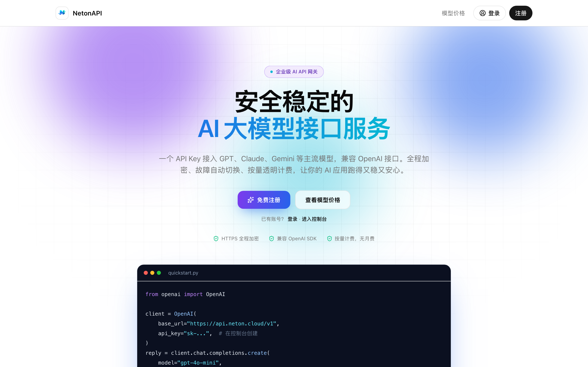
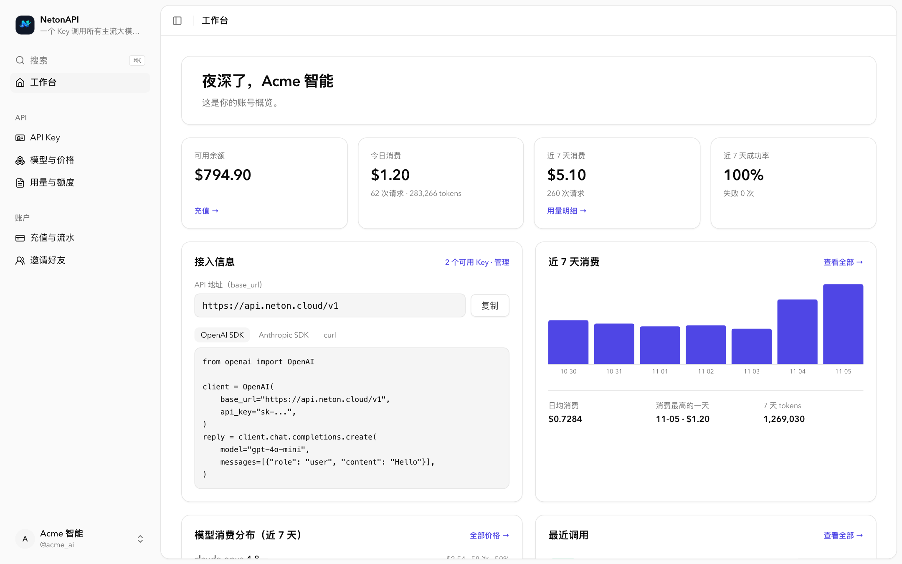
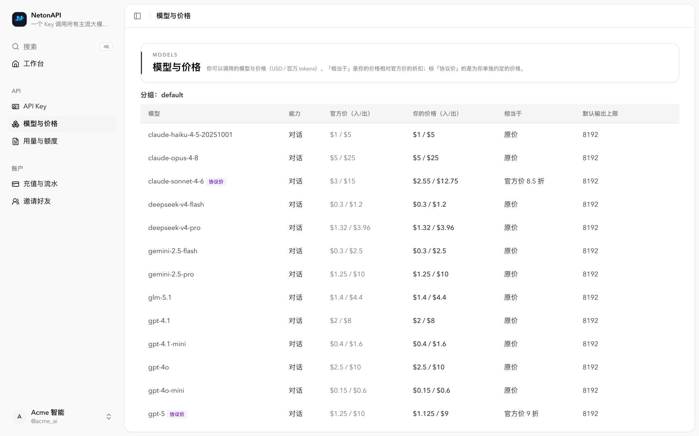
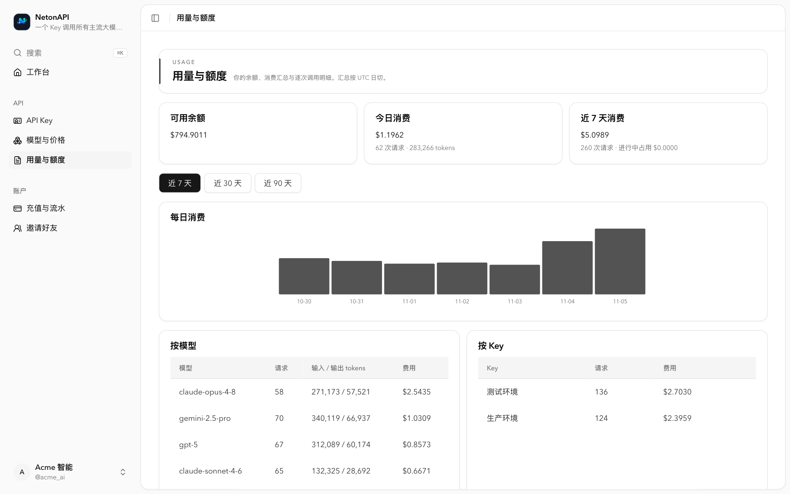
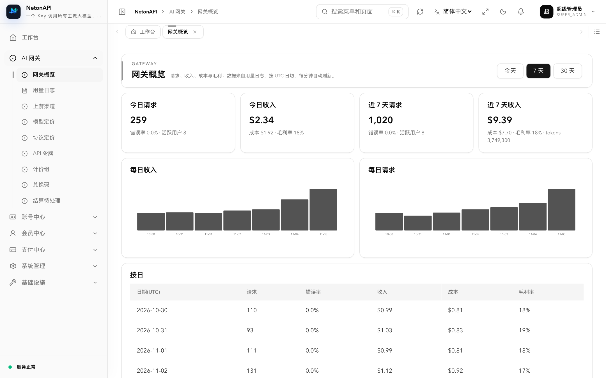
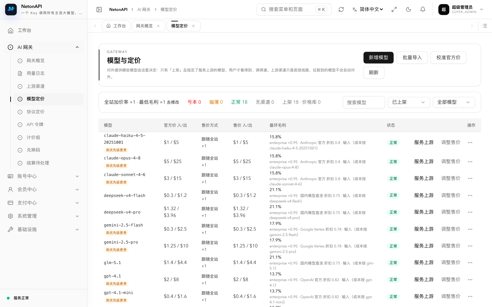
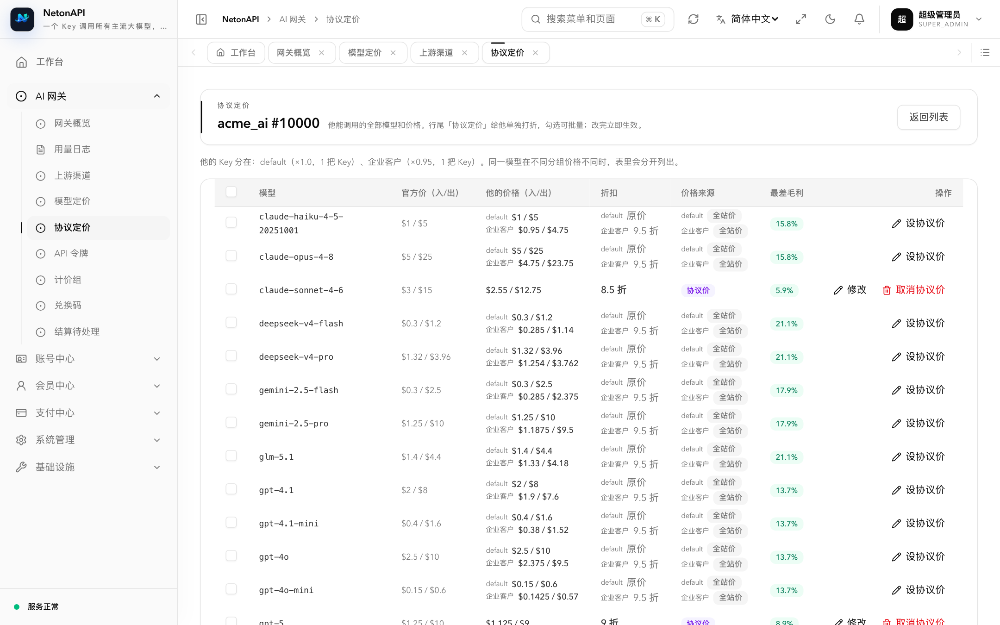

# NetonAPI Backend

**English** | [简体中文](./README.zh-Hans.md)

NetonAPI is a self-hosted LLM API gateway. One set of issued keys serves three upstream
protocol families — OpenAI, Anthropic, Gemini — relayed in any direction, with durable
billing, quota enforcement and channel failover. It is built with Kotlin/Native on the
[Neton](https://github.com/netonframework/neton) framework and the [Neton Application](https://github.com/neton-application/neton-application) scaffold, and compiles to a single static executable: no
JVM at runtime, no sidecar SQL files. See the [capability comparison](#capability-comparison)
with the two most widely used open-source relays, [`new-api`](https://github.com/QuantumNous/new-api) and [`one-api`](https://github.com/songquanpeng/one-api).

This repository is the **backend distribution**. It assembles the framework and the seven
canonical modules into one binary and owns the gateway-specific configuration. Product
logic lives in the module repositories, not here.

| | |
|---|---|
| Language | Kotlin 2.4.20 (Multiplatform) |
| Build | Gradle 8.14.4 + KSP 2.3.12 |
| Runtime | Kotlin/Native static executable (`application.kexe`), no JVM |
| Datastores | PostgreSQL (billing, ledger, channels) · Redis (optional: shared rate limits) |
| Default port | `8800` |
| License | [Apache-2.0](./LICENSE) |

Source repositories: [**netonapi/netonapi**](https://github.com/netonapi/netonapi) (this server),
[**netonapi/netonapi-admincp**](https://github.com/netonapi/netonapi-admincp) (operator console) and
[**netonapi/netonapi-web**](https://github.com/netonapi/netonapi-web) (public site and self-service console). Deployment, secrets, reverse-proxy and SSRF notes:
[`DEPLOY.md`](https://github.com/zoujiaqing/nanogate/blob/main/DEPLOY.md) in the `nanogate`
repository, which also carries the end-to-end test harness.

## Screenshots

Taken from the local demo environment (`harness/demo/up.sh`: fictional channels and users, randomized but realistic usage).

**For users**

| Home | Console |
|---|---|
|  |  |
| **Models and prices**: your price, its share of the official price, negotiated-price tags | **Usage**: daily spend, totals by model and by key |
|  |  |

**For operators**

| Gateway overview: revenue, cost, margin | Model pricing: worst margin of each model on every channel |
|---|---|
|  |  |

**Negotiated pricing**: give a key account "N% of the official price" per model, with their price and margin shown live; a discount that loses money cannot be saved.



## Capability comparison

NetonAPI is not a fork of one-api / new-api. It was designed from the **operator's** side: prices are anchored to the official
price, every channel carries its real cost, a price that would lose money cannot be saved, and every charge reconciles as
"unit price × tokens". The table compares it with the two most widely used open-source relay projects.

| Capability | NetonAPI 1.0 | [new-api](https://github.com/QuantumNous/new-api) | [one-api](https://github.com/songquanpeng/one-api) |
|---|---|---|---|
| **Pricing** | Anchored to the official price: sale = official × markup; groups and individual users can get "N% of official" per model | Ratio system: model ratio × completion ratio × group ratio; fixed per-request price; tiered expression pricing | Ratio system: group ratio × model ratio × completion ratio |
| **Per-user, per-model negotiated price** | Yes ("Negotiated pricing": find a user, discount model by model, in bulk) | Via user group ratio | Via user group ratio |
| **Real channel cost** | Each channel records its cost (official × discount / upstream pricing API / per-model manual); abnormal jumps wait for approval | Not covered in public docs | Not covered in public docs |
| **Margin protection** | A price below channel cost **cannot be saved**; price health check shows the worst margin per group × channel; profit dashboard | Not covered in public docs | Not covered in public docs |
| **Official price upkeep** | Scheduled sync from a price source; changes held for operator approval; full price history | Ratio settings, can sync upstream ratios | Built-in default ratios, edited by hand |
| **Charge vs. displayed price** | Charge = tokens × the unit price the user sees (rounded per item); console, price list and bill agree; unknown cache price bills at input price | Pre-deduct, then settle the difference | Pre-deduct, then settle |
| **Ledger** | Two-phase reserve → settle, crash-recoverable, anomalies go to a manual review queue; price snapshot frozen per request | Pre-deduct + post-settle | Pre-deduct + post-settle |
| **Billing group** | Decided by the API key; operators can pin a key to a group (dedicated route / special price) | User group, selectable per token | User and channel groups |
| **API key handling** | Shown once at creation, only a hash is stored; upstream keys encrypted at rest | Viewable and copyable in the list | Viewable and copyable in the list |
| **Inbound protocols** | Native OpenAI (Chat, Responses), Anthropic and Gemini endpoints, **converted in any direction** (tools, images, thinking, cache usage preserved) | Conversion among OpenAI Chat, Responses, Anthropic and Gemini; Realtime WebSocket | Unified to the OpenAI format |
| **Upstream types** | OpenAI-compatible, Azure OpenAI, Anthropic, Gemini, AWS Bedrock, Vertex AI | Dozens, domestic and international | 30+ providers |
| **Channel failover** | Priority + weight; automatic failover; an upstream "model not found" moves to the next channel instead of failing the user; key auto-disable and cooldown; scheduled probes | Priority + weight, retries, channel affinity, multiple keys | Load balancing, retries, auto-disable by success rate |
| **Task APIs** (Midjourney, video…) | Not yet | Yes (JavaScript plugins) | No |
| **Operator permissions** | Menu- and button-level permissions; preset gateway ops / finance / support / read-only roles | Fine-grained permissions | Admin / root |
| **User sign-in** | Username and password, SMS code (needs an SMS provider), email password reset | OAuth / OIDC, passkeys, 2FA | Email, GitHub, Feishu, WeChat |
| **Top-up** | Manual top-up by admins, redemption codes, online payment (Alipay, aggregators, pluggable); payment secrets write-only | Redemption codes, EPay, Stripe, subscriptions | Redemption codes, top-up link |
| **Build and deploy** | Kotlin/Native **single native executable**, no JVM at runtime; PostgreSQL (Redis optional) | Go binary / Docker; SQLite / MySQL / PostgreSQL | Go binary / Docker; SQLite / MySQL |
| **Status** | 1.0.0 | Releasing continuously (v1.0.0-rc series) | Latest release v0.6.10 (2025-02), none since |

The new-api and one-api columns are compiled from their public READMEs and documentation (2026-11). "Not covered in public docs" means
we found no description, not that the feature certainly does not exist; check their latest releases for details.

## Repository layout

This repo is **not self-contained**. `settings.gradle.kts` hardcodes `../../Neton/<repo>`,
so it must sit exactly two levels below the directory that holds `Neton/`:

```
projects/
├── Neton/
│   ├── neton-application-contract/         # module contracts
│   ├── neton-application-module-system/
│   ├── neton-application-module-infra/
│   ├── neton-application-module-account/
│   ├── neton-application-module-member/
│   ├── neton-application-module-payment/
│   └── neton-application-module-platform/
└── <workspace>/                            # any name for Gradle…
    └── netonapi-backend/                   # ← this repository
        └── module-gateway/                 # the NetonAPI gateway module (lives here, not in Neton/)
```

The contract and the modules are pulled in as **source subprojects** (`include(...)` +
`projectDir`) — each of them keeps its own `settings.gradle.kts` and stays independently buildable.
The Neton framework, `neton-ai` and `geolite4k` come from Maven Central at the versions in
`gradle.properties` (`netonVersion`, `netonAiVersion`, `geolite4kVersion`). To build against
unreleased framework changes, check out `neton`, `neton-ai` and `geolite4k` under `Neton/` and pass
`-Pnetonapi.frameworkSource=true`, which swaps them in as composite builds.

### Build prerequisites

Every repository listed above is public, so the build needs nothing beyond public sources.
The Docker build expects the outer
directory names `Neton/` and `NewGate/`, because its `COPY` sources are literal paths.

## Build

```bash
./gradlew :application:linkDebugExecutableMacosArm64      # Apple silicon dev build
./gradlew :application:linkReleaseExecutableLinuxX64      # the release artifact the image ships
./gradlew :module-gateway:macosArm64Test :module-system:macosArm64Test
```

Output: `application/build/bin/<target>/<debug|release>Executable/application.kexe`.
Kotlin/Native test tasks only run on a matching host architecture — a `linuxX64Test` task
cannot execute on an Apple silicon Mac — so CI splits the work: the macOS job compiles
`macosArm64` and runs the module unit tests, the Linux job builds `linuxX64` natively and
runs the reliability harness against that binary.

Declared targets: `macosArm64`, `linuxX64`, `linuxArm64`, `mingwX64`. Verified in practice:

| Target | Status |
|---|---|
| `macosArm64` | compiles, links, unit tests run (dev machine + the CI macOS job) |
| `linuxX64` | compiles, links and passes the harness on the CI Linux job; also cross-linked from macOS to a working ELF as a local check |
| `linuxArm64` | declared, **not verified** |
| `mingwX64` | declared, **not verified**; ships without a DNS resolver, so the SSRF re-check degrades to literal-only validation (see `DEPLOY.md`) |

## Run

```bash
./application.kexe migrate up     # apply migrations; also accepts `status` / `verify`
./application.kexe                # serve on :8800
```

Serving **never auto-migrates**: startup runs a precheck and aborts (exit 1) if migrations
are pending, failed, or mismatched. Migrations are embedded into the binary at compile time,
so there are no SQL files to ship and no working-directory assumptions.

Configuration lives in `application/config/*.conf` (`application.conf`, `database.conf`,
`routing.conf`, `storage.conf`, `geolite.conf`) and every value can be overridden by
environment variables — `NETON_` prefix, `__` for a dot, path lowercased
(`NETON_REDIS__HOST` → `redis.host`), plus `NETONAPI_*` for product knobs such as
`NETONAPI_CHANNEL_KEY_ENC_KEY`, `NETONAPI_SALE_MARKUP` and `NETONAPI_MIN_MARGIN`. Behind a
reverse proxy set `NETON_ROUTING__RATELIMIT__TRUSTED_PROXIES` (e.g. `127.0.0.1,::1`) so rate
limits, audit and token IP allowlists see the real client. Only PostgreSQL is supported.

Route groups (see `application/config/routing.conf`):

| Mount | Auth | Purpose |
|---|---|---|
| `/` | gateway `sk-` token | LLM relay: `/v1/chat/completions`, `/v1/messages`, `/v1/embeddings`, Gemini `:generateContent` / `:embedContent` |
| `/admin` | operator JWT | operator console API |
| `/app` | member JWT (HttpOnly cookie) | self-service console API |
| `/platform` | per endpoint | open-platform endpoints |

## Assembled modules

The module list has exactly one source of truth — `ksp { arg("neton.modules", ...) }` in
`application/build.gradle.kts`. KSP generates `GeneratedApplicationModules`, which the
`migrate` subcommand, the startup precheck and `serve` all consume, so adding or dropping a
module is a two-line change (a dependency plus an id) and cannot drift out of sync.

`system` · `infra` · `account` · `member` · `payment` · `platform` · `gateway`

## Tests

The behavioural test suite is the harness in the
[`nanogate` repository](https://github.com/zoujiaqing/nanogate) (`harness/run.sh`): it starts
the real gateway against a throwaway PostgreSQL database and an isolated `redis-server`, and
drives it scenario by scenario with Python fake upstreams — billing and settlement, pricing
rules and margin protection, protocol conversion, channel failover and cool-down, rate
limits, payments and top-ups, permissions, and the SSRF and XFF trust boundaries. It never
touches a Redis instance it did not start. `harness/live-e2e.py` runs the same kind of drill
against a deployed instance (see `docs/live-drill-spec.md`).

```bash
cd ..          # the workspace root that holds harness/
bash harness/run.sh                          # macOS: builds macosArm64 by default
NETONAPI_TARGET=linuxX64 bash harness/run.sh  # Linux
```

## Documentation

- [`docs/SPEC.md`](./docs/SPEC.md) — overall backend spec: repositories and assembly, layering,
  route groups, health checks, configuration, response envelope, pagination, migrations
- [`docs/ENGINEERING_RULES.md`](./docs/ENGINEERING_RULES.md) — the hard rules (module
  boundaries, what to grep before changing a public symbol, migration policy)
- [`docs/gateway-pricing-spec.md`](./docs/gateway-pricing-spec.md) — pricing rules: sale price modes, billing groups,
  margin protection, pricing check, official price calibration and price history
- [`docs/model-catalog-design.md`](./docs/model-catalog-design.md) — the offered model catalog: listed vs. price library, serving upstreams
- [`docs/key-billing-group-design.md`](./docs/key-billing-group-design.md) — billing groups come from the API key
- [`docs/api-key-spec.md`](./docs/api-key-spec.md) — API keys: user-created only, shown once, ops supervision and limits
- [`docs/recharge-spec.md`](./docs/recharge-spec.md) — credit and top-ups: manual top-up, online checkout, sandbox, payment sync; no mock top-up
- [`docs/console-and-site-spec.md`](./docs/console-and-site-spec.md) — public site and user console
- [`docs/live-drill-spec.md`](./docs/live-drill-spec.md) — live drill and mock upstreams
- [`docs/relay-errors-spec.md`](./docs/relay-errors-spec.md) — relay error handling: fail over on upstream account errors, no leaking internals, cross-protocol paths
- [`docs/rbac-spec.md`](./docs/rbac-spec.md) — User/Role/Menu, permission strings, wildcards
- [`docs/module-template-spec.md`](./docs/module-template-spec.md) — how to add a module

## Known gaps

Deliberately listed rather than hidden:

- CORS `Access-Control-Allow-Origin` is **hardcoded to `*`** in `Main.kt` and is not a config
  value — Neton's TOML parser cannot parse arrays. `allowCredentials = false`, so browsers
  send no cookies cross-origin; the admin UI therefore shares the API origin through Caddy
  (production) or Next dev rewrites (local). Tightening the allowlist means editing code.
- `security.unified_token.enabled` must stay `false`: no module in this distribution binds a
  `UnifiedTokenAuthenticator`. The startup error says so explicitly.
- The Docker/compose build path has not been executed on a real Docker host yet. Health
  checks: `GET /health` (liveness + database, used by the image's `HEALTHCHECK`) and
  `GET /admin/system/health/ready` (database and Redis).
- SMTP with TLS relies on the system libcurl (present on macOS and in the Debian image);
  the Windows build only supports plaintext SMTP and should use a vendor HTTP mail API.

## License

Apache-2.0 — see [LICENSE](./LICENSE).
