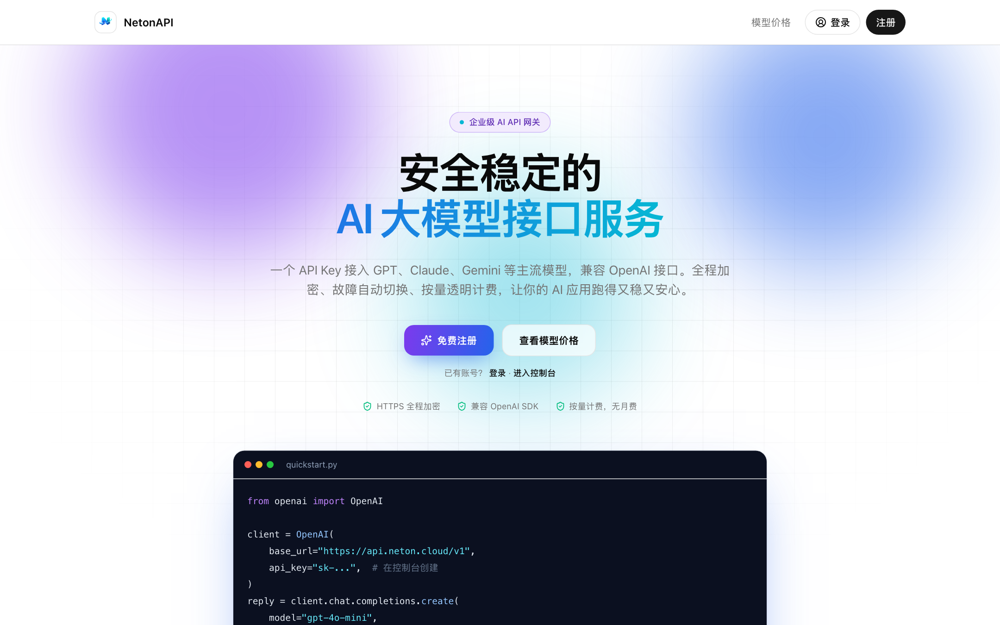
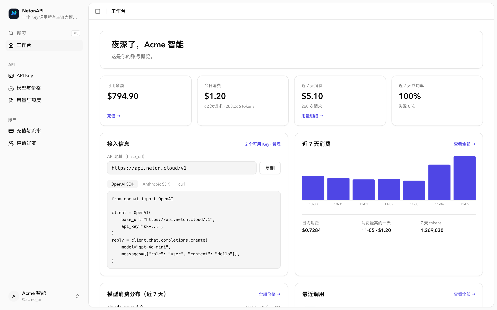
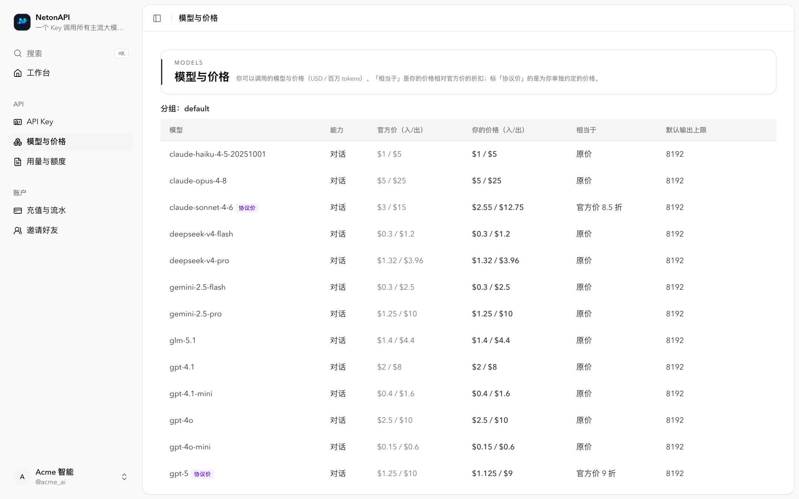
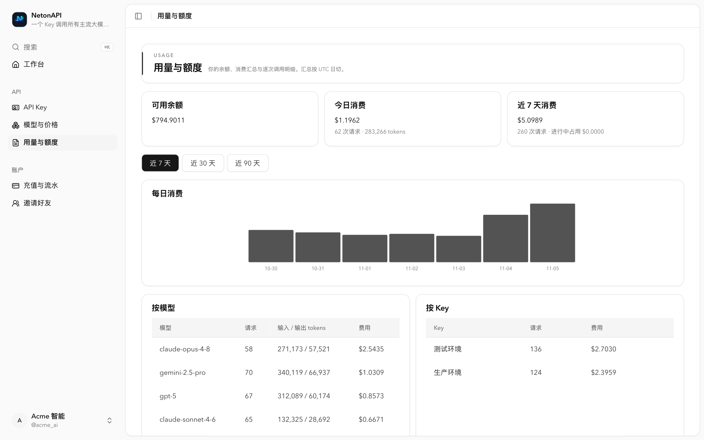
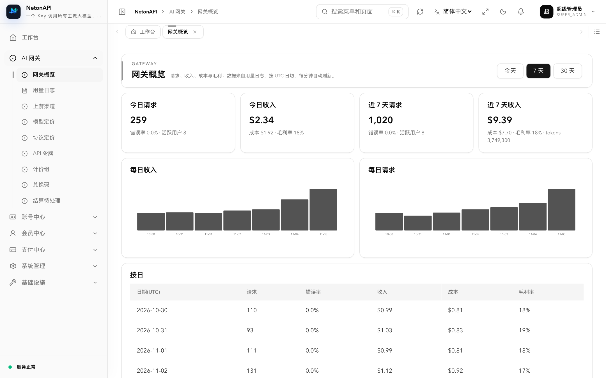
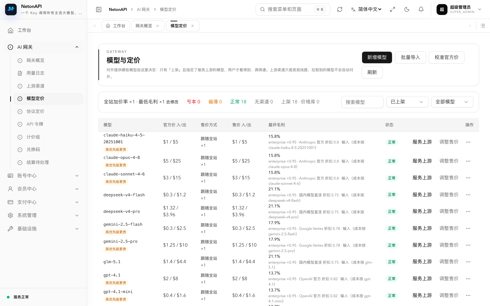
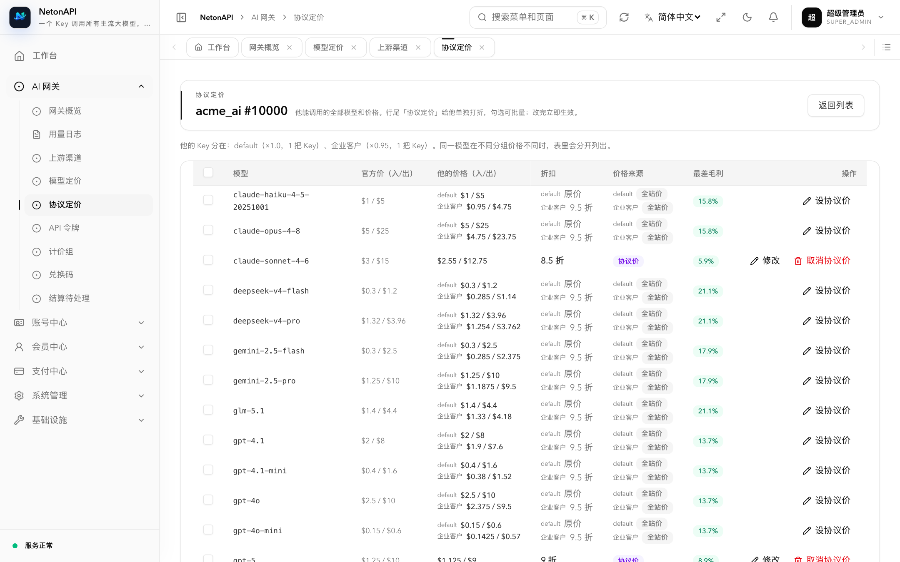

# NetonAPI 后端

[English](./README.md) | **简体中文**

NetonAPI 是一个自托管的 LLM API 网关：自己签发一套 Key，背后对接三个上游协议族
（OpenAI、Anthropic、Gemini）并**任意方向互转**，同时负责计费、配额与渠道容错。使用 Kotlin/Native，基于 [Neton](https://github.com/netonframework/neton) 框架与 [Neton Application](https://github.com/neton-application/neton-application) 脚手架打造，
编译成单个静态可执行文件：运行期没有 JVM，也没有需要随包分发的 SQL 文件。
与主流开源中转站 [`new-api`](https://github.com/QuantumNous/new-api)、[`one-api`](https://github.com/songquanpeng/one-api) 的差异见下方[能力对照](#能力对照)。

本仓是**后端发行版**：把框架与七个 canonical 模块装配成一个二进制，并持有网关相关的配置。
产品逻辑在各模块仓里，不在这里。

| | |
|---|---|
| 语言 | Kotlin 2.4.20（Multiplatform） |
| 构建 | Gradle 8.14.4 + KSP 2.3.12 |
| 运行形态 | Kotlin/Native 静态可执行文件（`application.kexe`），无 JVM |
| 存储 | PostgreSQL（计费、账本、渠道）· Redis（可选：跨实例共享限流） |
| 默认端口 | `8800` |
| 许可 | [Apache-2.0](./LICENSE) |

源码仓库：[**netonapi/netonapi**](https://github.com/netonapi/netonapi)（服务端，即本仓）、
[**netonapi/netonapi-admincp**](https://github.com/netonapi/netonapi-admincp)（管理后台）、
[**netonapi/netonapi-web**](https://github.com/netonapi/netonapi-web)（网站前端：门户首页、价格页与用户控制台）。
部署、密钥、反向代理与 SSRF 说明见 `nanogate` 仓的
[`DEPLOY.md`](https://github.com/zoujiaqing/nanogate/blob/main/DEPLOY.md)，端到端测试 harness 也在那里。

## 截图

以下截图来自本地演示环境（`harness/demo/up.sh`：虚构的渠道与用户、随机但贴近真实的用量）。

**用户侧**

| 首页 | 控制台 |
|---|---|
|  |  |
| **模型与价格**：你的价格、相当于官方价几折、协议价标记 | **用量与额度**：每日消费、按模型 / 按 Key 汇总 |
|  |  |

**运营侧**

| 网关概览：收入、成本、毛利 | 模型定价：每个模型在每条渠道上的最差毛利 |
|---|---|
|  |  |

**协议定价**：给大客户按模型打「官方价 N 折」，实时显示他的价格与毛利，亏本的折扣保存不了。



## 能力对照

NetonAPI 不是在 one-api / new-api 上改出来的分支，而是从**运营平台**的角度重新设计：定价以官方价为锚、每条渠道核算真实成本、
亏本的价格保存不了、每一笔扣费都能按「单价 × tokens」逐笔对上。下表对照的是两个最主流的开源中转站项目。

| 能力 | NetonAPI 1.0 | [new-api](https://github.com/QuantumNous/new-api) | [one-api](https://github.com/songquanpeng/one-api) |
|---|---|---|---|
| **定价方式** | 以官方价为锚：售价 = 官方价 × 加价率；分组、单个用户都可按模型谈「官方价 N 折」 | 倍率体系：模型倍率 × 补全倍率 × 分组倍率；按次固定价；分档表达式定价 | 倍率体系：分组倍率 × 模型倍率 × 补全倍率 |
| **按用户 × 模型的协议价** | 有（「协议定价」页：搜用户、逐模型打折、可批量） | 按用户分组倍率区分 | 按用户分组倍率区分 |
| **渠道真实成本** | 每条渠道记录拿货价（官方价折扣 / 拉取上游价目接口 / 按模型手填），异常变动挂起待确认 | 公开文档未涉及 | 公开文档未涉及 |
| **毛利保护** | 售价低于渠道成本的定价**保存不了**；定价体检列出每个「分组 × 渠道」的最差毛利；利润看板 | 公开文档未涉及 | 公开文档未涉及 |
| **官方价维护** | 定时从价源同步官方价，涨跌先挂起由运营确认，完整调价记录 | 倍率设置，可同步上游倍率 | 内置默认倍率，手动调整 |
| **扣费与展示** | 扣费 = tokens × 用户看到的单价（逐项取整），控制台、价格表、账单三处一致；缓存价缺失时按输入价计，不白送缓存命中 | 预扣后按实际用量多退少补 | 预扣后按实际用量结算 |
| **账务** | 预留 → 结算两阶段，进程崩溃可恢复，异常进入人工复核队列；每笔请求冻结定价快照 | 预扣 + 后结算 | 预扣 + 后结算 |
| **计费分组** | 由 API Key 决定：运营可直接指定到某把 Key（专线 / 特价） | 用户分组，令牌可选分组 | 用户分组、渠道分组 |
| **API Key 安全** | 只在创建时显示一次，库里只存哈希；渠道上游 Key 加密存储 | 列表中可查看、复制 | 列表中可查看、复制 |
| **接入协议** | OpenAI（Chat、Responses）、Anthropic、Gemini 原生入口，**任意方向互转**（工具调用、图片、thinking、缓存用量保真） | OpenAI Chat、Responses、Anthropic、Gemini 四种文本协议互转；另有 Realtime WebSocket | 统一为 OpenAI 格式 |
| **上游类型** | OpenAI 兼容站、Azure OpenAI、Anthropic、Gemini、AWS Bedrock、Vertex AI | 数十种，含国内外厂商 | 30 余家国内外厂商 |
| **渠道容错** | 优先级 + 权重；失败自动换渠道；上游说「没有这个模型」时换渠道而不是报错给用户；Key 自动停用与冷却；定时测速 | 优先级 + 权重、重试、渠道亲和、多 Key | 负载均衡、失败重试、按成功率自动禁用 |
| **任务类接口**（Midjourney、视频等） | 暂不支持 | 支持（JS 插件扩展） | 不支持 |
| **运营权限** | 菜单与按钮级权限，预置网关运营 / 财务 / 客服 / 只读四个角色 | 细粒度权限 | 管理员 / 超级管理员 |
| **用户登录** | 账号密码、手机验证码（需配短信）、邮箱找回密码 | OAuth / OIDC、Passkey、两步验证 | 邮箱、GitHub、飞书、微信公众号 |
| **充值** | 管理员手动充值、兑换码、在线支付（支付宝、四方支付，可扩展）；支付密钥只写不读 | 兑换码、易支付、Stripe、订阅 | 兑换码、充值链接 |
| **实现与部署** | Kotlin/Native **单个原生可执行文件**，运行期无 JVM；PostgreSQL（Redis 可选） | Go 单二进制 / Docker；SQLite / MySQL / PostgreSQL | Go 单二进制 / Docker；SQLite / MySQL |
| **项目状态** | 1.0.0 正式版 | 持续发布（v1.0.0-rc 系列） | 最新版本 v0.6.10（2025-02），此后无新版本 |

new-api、one-api 两列依据各自公开的 README 与文档整理（2026-11），「公开文档未涉及」表示没有找到相关说明，不代表一定没有；细节以对方最新版本为准。

## 仓库布局

本仓**不能独立构建**。`settings.gradle.kts` 里写死了 `../../Neton/<repo>`，
所以它必须正好落在持有 `Neton/` 的那层目录的**两层深处**：

```
projects/
├── Neton/
│   ├── neton/                              # 框架（includeBuild）
│   ├── neton-ai/                           # LLM 协议编解码（includeBuild）
│   ├── geolite4k/                          # GeoIP（includeBuild）
│   ├── neton-application-contract/         # 模块间契约（includeBuild）
│   ├── neton-application-module-system/
│   ├── neton-application-module-infra/
│   ├── neton-application-module-account/
│   ├── neton-application-module-member/
│   ├── neton-application-module-payment/
│   └── neton-application-module-platform/
└── <workspace>/                            # Gradle 不关心这层叫什么…
    └── netonapi-backend/                   # ← 本仓
        └── module-gateway/                 # NetonAPI 的网关模块（就在本仓，不在 Neton/ 下）
```

框架与模块是以**源码子项目**方式引入的（`include(...)` + `projectDir`），不是 `includeBuild`——
每个模块仓保留自己的 `settings.gradle.kts`，仍可独立构建。只有 `neton`、`neton-ai`、`geolite4k` 与
`neton-application-contract` 是 composite build。

### 构建前提

构建需要上面每个仓的读权限。`neton-application-module-infra` 目前是私有仓，在它公开之前，只凭公开源码无法构建。Docker 构建还要求外层目录名是 `Neton/` 与 `NewGate/`，因为 `COPY` 源是字面路径。

## 构建

```bash
./gradlew :application:linkDebugExecutableMacosArm64      # Apple silicon 开发构建
./gradlew :application:linkReleaseExecutableLinuxX64      # 镜像用的 release 产物
./gradlew :module-gateway:macosArm64Test :module-system:macosArm64Test
```

产物在 `application/build/bin/<target>/<debug|release>Executable/application.kexe`。
Kotlin/Native 的测试任务只能在架构匹配的宿主上运行——Apple silicon 的 Mac 跑不了 `linuxX64Test`——
所以 CI 把两件事分开：macOS job 编译 `macosArm64` 并跑模块单测，Linux job 原生构建 `linuxX64`
并用它跑整个可靠性 harness。

声明的目标：`macosArm64`、`linuxX64`、`linuxArm64`、`mingwX64`。实际验证情况：

| 目标 | 状态 |
|---|---|
| `macosArm64` | 编译、链接、单测均通过（开发机与 CI 的 macOS job） |
| `linuxX64` | 在 CI 的 Linux job 上编译、链接并跑通 harness；也曾在 macOS 上交叉链接出可运行的 ELF 做本地验证 |
| `linuxArm64` | 已声明，**未验证** |
| `mingwX64` | 已声明，**未验证**；不带 DNS 解析器，SSRF 复查退化为只做字面量校验（见 `DEPLOY.md`） |

## 运行

```bash
./application.kexe migrate up     # 执行迁移；也接受 `status` / `verify`
./application.kexe                # 在 :8800 提供服务
```

服务启动**绝不自动迁移**：启动时跑 precheck，发现迁移待执行 / 失败 / 不匹配就 fail-fast（exit 1）。
迁移 SQL 在编译期被 embed 进二进制，所以没有 sidecar SQL 文件，也不依赖工作目录。

配置在 `application/config/*.conf`（`application.conf`、`database.conf`、`routing.conf`、
`storage.conf`、`geolite.conf`），每一项都能用环境变量覆盖——`NETON_` 前缀、`__` 表示点、路径小写
（`NETON_REDIS__HOST` → `redis.host`）；产品自身的开关用 `NETONAPI_*`，如
`NETONAPI_CHANNEL_KEY_ENC_KEY`、`NETONAPI_SALE_MARKUP`、`NETONAPI_MIN_MARGIN`。部署在反代之后须配
`NETON_ROUTING__RATELIMIT__TRUSTED_PROXIES`（如 `127.0.0.1,::1`），限流、审计与令牌 IP 白名单才能拿到真实客户端。
数据库只支持 PostgreSQL。

路由组（见 `application/config/routing.conf`）：

| 挂载点 | 认证 | 用途 |
|---|---|---|
| `/` | gateway 的 `sk-` TokenGuard | LLM 中转：`/v1/chat/completions`、`/v1/messages`、`/v1/embeddings`、Gemini `:generateContent` / `:embedContent` |
| `/admin` | 管理员 JWT | 管理台 API |
| `/app` | 会员 JWT（HttpOnly Cookie） | 用户控制台 API |
| `/platform` | 按接口 | 开放平台端点 |

## 装配的模块

模块列表只有一个来源：`application/build.gradle.kts` 里的 `ksp { arg("neton.modules", ...) }`。
KSP 生成 `GeneratedApplicationModules`，`migrate` 子命令、启动 precheck 与 `serve` 三处共用，
所以增删模块是两行改动（一个依赖 + 一个 id），不会出现三份列表各自漂移。

`system` · `infra` · `account` · `member` · `payment` · `platform` · `gateway`

## 测试

行为测试是 [`nanogate` 仓](https://github.com/zoujiaqing/nanogate)里的 harness（`harness/run.sh`）：
它在一个用完即弃的 PostgreSQL 库和一个隔离的 `redis-server` 上启动真实网关，用 Python 假上游逐场景断言——
计费与结算、定价规则与毛利保护、协议互转、渠道容错与冷却、限流、支付与充值、权限、SSRF 与 XFF 信任边界。
它绝不碰不是自己启动的 Redis 实例。`harness/live-e2e.py` 对已部署的实例跑同类演练（见 `docs/live-drill-spec.md`）。

```bash
cd ..          # 含 harness/ 的工作区根目录
bash harness/run.sh                          # macOS：默认构建 macosArm64
NETONAPI_TARGET=linuxX64 bash harness/run.sh  # Linux
```

## 文档

- [`docs/SPEC.md`](./docs/SPEC.md) —— 后端总规范：仓库与装配、分层、路由组、健康检查、配置、响应体、分页、迁移
- [`docs/ENGINEERING_RULES.md`](./docs/ENGINEERING_RULES.md) —— 硬规范（模块边界、改 public
  symbol 前要 grep 哪些仓、迁移策略）
- [`docs/gateway-pricing-spec.md`](./docs/gateway-pricing-spec.md) —— 计价规则：售价方式、计费分组、毛利保护、定价体检、官方价校准与调价记录
- [`docs/model-catalog-design.md`](./docs/model-catalog-design.md) —— 对外模型目录：上架 / 价格库、模型的服务上游
- [`docs/key-billing-group-design.md`](./docs/key-billing-group-design.md) —— 计费分组由 API Key 决定：可选范围、运营指定、收回即 403
- [`docs/api-key-spec.md`](./docs/api-key-spec.md) —— API Key：只能用户自建、明文只显示一次、运营监管与限速
- [`docs/recharge-spec.md`](./docs/recharge-spec.md) —— 充值与额度：手动充值、在线充值流程、沙箱支付、同步支付状态，没有模拟充值
- [`docs/console-and-site-spec.md`](./docs/console-and-site-spec.md) —— 门户首页 / 价格页与用户控制台
- [`docs/live-drill-spec.md`](./docs/live-drill-spec.md) —— 线上演练与模拟上游
- [`docs/relay-errors-spec.md`](./docs/relay-errors-spec.md) —— 转发错误处理：上游账号错误换渠道、不透传内部信息、跨协议路径
- [`docs/rbac-spec.md`](./docs/rbac-spec.md) —— User/Role/Menu、权限串、通配
- [`docs/module-template-spec.md`](./docs/module-template-spec.md) —— 怎么加一个模块

## 已知缺口

刻意列出来，不藏：

- CORS 的 `Access-Control-Allow-Origin` 在 `Main.kt` 里**硬编码为 `*`**，不是配置项——
  Neton 的 TOML parser 解析不了数组。`allowCredentials = false`，浏览器跨站不带 cookie，
  但要收紧白名单只能改代码重新编译。
- `security.unified_token.enabled` 必须保持 `false`：本发行版没有任何模块 bind
  `UnifiedTokenAuthenticator`，启动时的报错信息已经把这件事写明了。
- Docker / compose 构建路径尚未在真实 Docker 宿主上跑过。健康检查：`GET /health`（存活 + 数据库，镜像的
  `HEALTHCHECK` 用它）与 `GET /admin/system/health/ready`（数据库与 Redis）。

## 许可

Apache-2.0 —— 见 [LICENSE](./LICENSE)。
